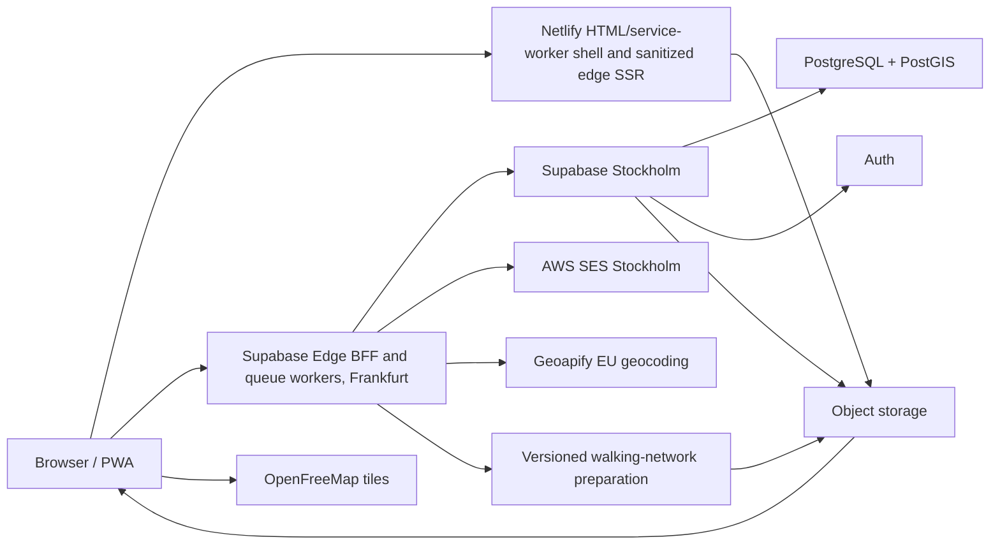

# Promenadis technical architecture

Status: approved creation baseline, 2026-09-07

## 1. Architecture summary

The web shell supports device/light/dark appearance using CSS `color-scheme` and
paired `light-dark()` colors. A small same-origin bootstrap applies the optional
`promenadis-theme` local-storage preference before paint; React hydrates the
selector from a stable default. Only the root element permits the intentional
bootstrap attribute difference. Storage failures fall back to device preference;
no account, backend record, or authentication material is involved.

Promenadis should use a server-capable React/TypeScript web architecture with a
portable PostgreSQL core and a deliberately small set of managed services.



Initial providers:

| Concern | Choice | Notes |
| --- | --- | --- |
| Web/SSR/CDN | Netlify Free initially | Small HTML/service-worker shell and sanitized public edge SSR; Personal only as a funded event-month upgrade |
| Database/backend | Supabase Stockholm | Free for development/closed alpha; Pro while real public events require non-pausing production |
| Authenticated BFF/workers | Supabase Edge Functions, Frankfurt | Versioned JSON API and I/O-bound queue consumers near the Stockholm database |
| Transactional email | AWS SES, Stockholm | Supabase custom SMTP plus app mail |
| Base map | OpenFreeMap | Commercial use allowed; public service has no meaningful SLA |
| Geocoding | Geoapify EU | Server-side adapter, cached results, manual-pin fallback |
| Future tile hosting | Cloudflare R2/Workers + PMTiles | Only if traffic or reliability warrants it |

Development/closed alpha uses free tiers. Public production has a hard 350
SEK/month personal out-of-pocket gate, including VAT and projected variable
usage. If it cannot fit, launch waits for external funding. The normal pilot
target is Supabase Pro plus minimal metered AWS usage while Netlify remains Free.
Across providers, prefer free/freemium or metered pay-as-you-go services with
hard limits and reversible upgrades. Fixed tiers are enabled only for a measured
event reliability/capacity need or external funding; do not automatically turn
on overages or recharge.

## 2. Web application

- TypeScript and React.
- Vite-compatible, server-capable framework configuration, likely React Router
  framework mode rather than a browser-only SPA.
- Mobile-first PWA.
- Server rendering or prerendering for public event landing pages, link previews,
  and event discovery.
- Netlify rendering handles only the small HTML/service-worker shell and
  sanitized public snapshot data. Content-addressed JavaScript, CSS, fonts, and
  other immutable application assets are stored beside public artifacts in
  Supabase Storage and served through Smart CDN. Netlify never executes
  authenticated/private domain commands.
- Exact seller coordinates and seller content must not be placed in indexed HTML
  before the applicable publication window. Public seller/location routes should
  be excluded from search indexing even while visible on the live event map.
- Shared packages should contain domain types, validation, API clients, search
  semantics, and routing logic so a later React Native app can reuse business
  logic without pretending it can reuse all web UI/CSS.
- Authenticated UI routes separate the event index, event creation, individual
  event workspace, boundary editor, registration-window editor, and account
  settings. They may read the current allowlisted dashboard DTO initially, but
  route composition must not expose unrelated backend resources on one page. The
  creation sequence persists a private draft after the Basics step, then
  addresses boundary and review using that opaque event ID. Map drawing is the
  primary boundary interaction; the structured coordinate controls remain
  accessible inside an advanced disclosure.

### Discovery and crawler policy

- Only a published public event's sanitized landing page is indexable. It uses a
  stable self-canonical URL and allowlisted Open Graph/JSON-LD containing title,
  description, organizer, locality, schedule, and lifecycle status. Public
  discovery, organizer listings, and the production XML sitemap derive from the
  same authoritative visibility/lifecycle state.
- Map/route shells and seller/location detail routes always emit robots metadata
  and `X-Robots-Tag: noindex, nofollow, nosnippet, noimageindex`, for both public
  and unlisted events. Exact coordinates, addresses, seller text, map images,
  and snapshot/object URLs cannot enter indexed HTML or structured metadata.
- Unlisted landing pages and resources use the same no-index policy plus
  `Referrer-Policy: no-referrer`. Their nonsequential route token has at least
  128 bits of entropy. They never enter discovery, public organizer listings,
  feeds, recommendations, or sitemaps.
- Keep crawlers able to fetch no-index pages so they can read the directive.
  `robots.txt` may reduce crawl traffic but is never access control and must not
  be used to conceal unlisted or residential data.
- Manifests, snapshots, safety feeds, and routing packages use opaque content-
  addressed URLs, correct non-HTML content types, and are not linked from
  indexable HTML. Verify effective response headers at the final storage/CDN
  edge before pilot launch. If Supabase Storage/Smart CDN cannot emit the
  required `X-Robots-Tag`, serve these objects through a thin header-setting
  asset domain before any real event.
- An unlisted URL rotation atomically revokes the old token; the old route
  returns `410` with no redirect. Deleted known routes also return `410`, unknown
  routes `404`. Public-to-unlisted transitions immediately remove discovery and
  sitemap membership and apply no-index directives. Unlisted-to-public after a
  seller joins is a versioned disclosure change that republishes that seller
  only after explicit reconfirmation. Visibility is immutable after activation
  except for the safety-oriented unlisted-token rotation command.
- Public status metadata updates on postponement, rescheduling, or cancellation
  without seller/location data. At archival, remove sitemap membership and
  apply no-index while allowing the minimal direct history shell. Unlisted pages
  remain no-index throughout.

Crawler directives are defense in depth, not a confidentiality boundary. The
product and incident runbook must not promise immediate removal from third-party
caches or devices that already downloaded public data.

### Accessibility baseline

- Treat WCAG 2.2 Level AA as an end-to-end requirement for every first-party
  role and both launch languages, not merely a component-library checklist.
- Build the visitor's structured stop/search/route/progress list as a peer to the
  MapLibre view. The list exposes every selected stop, availability state,
  estimated leg, route warning, disconnected/manual gap, and progress command.
  Map selection synchronizes with the list without moving keyboard focus or
  announcing irrelevant pan/zoom noise.
- Boundary and pin tools provide labelled address/search inputs, an ordered
  selected-point representation, coordinate/value fields where appropriate, and
  explicit add, move, reorder, and delete controls. Pointer drag and multi-touch
  gestures cannot be the sole way to complete a task.
- Prefer native semantic HTML; use ARIA only for missing semantics. Manage focus
  across dialogs and route transitions, announce validation and async state with
  bounded live regions, preserve input after recoverable errors, respect reduced
  motion and browser zoom/reflow, and never encode route/seller state by color
  alone.
- Authentication, OTP/magic-link, TOTP, CAPTCHA fallback, destructive actions,
  exports, moderation, and admin elevation receive the same accessibility test
  coverage. Do not block paste or password managers or introduce cognitive-
  function puzzles.
- Automated axe-style checks run on representative components and Playwright
  critical flows, but cannot establish conformance. Before public pilot, manually
  exercise every critical flow with keyboard only, 200% and 400% zoom, high-
  contrast and reduced-motion settings, iOS VoiceOver, Android TalkBack, and at
  least one desktop screen-reader/browser combination. A critical barrier with
  no usable alternative blocks launch; other defects need an owner and target
  date.
- The footer-linked accessibility statement derives from an explicit reviewed
  record of target, current conformance assessment, known limitations and
  alternatives, tested environments, review date, and feedback routes. Default
  to `not assessed` or `partially conformant` until evidence supports a stronger
  claim.

### Browser, PWA, and offline policy

- Build against web standards and runtime feature detection, not a user-agent
  allowlist. Tier 1 mobile is current/previous supported iOS/iPadOS Safari and
  current plus two preceding Chrome releases on Android 10+. Test both browser
  and installed modes. Tier 1 desktop is current plus two preceding stable
  Chrome, Edge, Firefox, and Safari releases on supported operating systems.
- Provide one HTTPS web manifest with stable `id`, explicit `scope`/`start_url`,
  localized presentation, complete icons, theme/background colors, and
  `standalone` display. Register a scoped service worker after the first usable
  render. Do not add store wrappers at launch or make installed state a domain
  permission/entitlement input.
- Use browser-native install affordances. Any in-app suggestion is contextual,
  dismissible, frequency-capped, absent during active navigation, and available
  only when the relevant platform flow can be explained accurately. Do not rely
  on Chromium's nonstandard `beforeinstallprompt` for iOS.
- Map/WebGL failure falls back to the peer structured list. Worker failure falls
  back to nonoptimized/manual ordering. Storage denial/quota/eviction falls back
  to online browsing and local in-memory progress with a clear loss-risk warning.
  Constrained embedded browsers may recommend opening the same URL in the system
  browser without losing the event route token.
- The service worker caches a minimal shell and offline fallback. Only an
  explicit `prepare/start route` action admits the currently valid allowlisted
  event snapshot and walking package to the managed 50 MiB IndexedDB/Cache
  budget. Selected route and progress are local-first. Offline basemap tiles are
  opportunistic browser/provider cache entries, not a managed completeness
  promise or bulk tile download.
- Every offline view exposes last refresh, connectivity, and inability to check
  new safety state. On reconnect, validate manifest and safety feed before
  syncing progress or resolving new exact-location requests. Clients reject hard-
  expired snapshots/packages regardless of installed state or cached bytes.
- Reconcile only idempotent visitor progress before event expiry. Do not queue
  auth, participation, event-team, moderation/admin, report, relay, export, or
  other sensitive commands offline; success UI requires an authoritative server
  response.
- Version shell/data caches separately. A waiting normal service-worker update
  never forces reload, clears, or changes an active route; activate at a safe
  boundary after user notice. Server safety state and expiry stay independent of
  shell rollout. Provide an app-level cache repair/reset path.
- Before each public pilot, test real iPhone and Android hardware for install,
  quota/eviction, offline/reconnect, geolocation permission changes, foreground/
  background transitions, and update during an active walk. Publish the rolling
  support matrix rather than hard-code ephemeral versions in general UI copy.

Possible future monorepo shape:

```text
apps/
  web/
  mobile/                 # deferred
packages/
  domain/
  api-client/
  routing/
  validation/
  i18n/
supabase/
  migrations/
  functions-or-server-contracts/
docs/
```

Milestone 0 locks the initial repository layout as a pnpm workspace with
`apps/web`, `packages/domain`, `packages/contracts`, and `packages/i18n`.
Backend SQL and local-service configuration live under `supabase`. Add
`packages/api-client`, `packages/routing`, and further adapters only when their
vertical slice needs them; do not create placeholder packages merely to mirror
the conceptual diagram.

## 3. API and authorization boundary

Use an API-first backend-for-frontend boundary:

- Browser authentication uses the private BFF's opaque-cookie session gateway;
  Supabase credentials are not browser-readable.
- The versioned `/api/v1` BFF runs in Supabase Edge Functions forced to
  `eu-central-1` (Frankfurt), the closest supported function region to the
  Stockholm database.
- Public discovery reads use typed server/CDN endpoints returning sanitized
  event snapshots.
- Authenticated and security-sensitive commands use typed server endpoints.
- Multi-table state changes execute transactionally in the database.
- PostgreSQL row-level security is defense in depth, not the only authorization
  mechanism.
- Exact coordinates, private addresses, reports, audit records, and identities
  are never fetched broadly and filtered only in the browser.
- Owner-facing event audit endpoints expose only the acting team member's stable
  event display label and role. Private actor identifiers and restricted seller
  or reporter identities remain in separately authorized server-side views.
- Future mobile clients use the same versioned domain API.

Decision update, 2026-09-15: browser authentication/session handling now crosses
the private BFF too; the earlier direct-browser Auth exception is superseded.
The browser receives a random opaque HttpOnly, SameSite=Lax cookie and a strict
session DTO containing only account ID/email. No Supabase access/refresh token or
PKCE verifier is returned to browser JavaScript or browser storage. An emailed
magic link still visits Auth's verification endpoint before the same-browser
callback; the BFF performs its PKCE exchange.

The local Vite `/api/*` proxy forwards to the existing Supabase Edge BFF
`/browser/*` gateway. Hashed 256-bit cookie handles index AES-GCM-encrypted
credentials in `app_private.browser_sessions`, protected by forced RLS and
service-only named RPCs. There is no additional service or paid dependency.
Auth sessions expire absolutely after 12 hours; pending logins after 15 minutes
or five verification attempts. Successful verification, logout, account erasure,
and a minutely expiry sweep remove applicable state. Database leases serialize
token refresh/verification across workers, and lease-checked updates fail closed.
The gateway validates the user and the JWT's live Auth session/account binding.

Implemented 2026-11-01: the shared BFF actor resolver validates the exact token
with Auth before extracting its `sub`, `session_id`, expiry and AMR evidence.
The service-only `is_active_auth_session` RPC checks the session/account pair
and any explicit `not_after` deadline for both cookie-bridged and direct bearer
calls. Missing/revoked sessions are denied; lookup failures fail closed.
Sensitive-command timestamps come only from supported sign-in AMR entries
(OTP/magic link; password for existing synthetic fixtures), never account-wide
`last_sign_in_at`, token `iat`, refresh events or editable metadata. Missing,
unsupported or malformed AMR cannot grant recent-auth permission. Existing SQL
commands retain their 15-minute policy and bounded clock-skew check.
No new identity data is retained, and the BFF does not mutate Auth-owned tables.
Provider references: [JWT claims](https://supabase.com/docs/guides/auth/jwt-fields)
and [session revocation](https://supabase.com/docs/guides/auth/sessions),
checked 2026-11-01. Decoding alone is never signature validation.

Every protected browser request includes the account ID whose page initiated
it; a different cookie identity returns 409 before any domain operation.
Account-scoped React state remounts on identity changes, checked on focus,
visibility, same-window events and cross-tab broadcasts. Stale request results
cannot populate the replacement account's component tree. Mutations require an
allowlisted Origin, JSON and a custom browser header; credentialed responses
are non-cacheable. Read requests require that header plus an allowed Origin or
same-origin fetch metadata. No legacy localStorage token is migrated into a
cookie; known legacy credential keys are discarded and the user signs in again.

This implementation is explicitly LOCAL ONLY. HTTP development cookies omit
Secure, and AES keys are domain-separated from the local service key. Hosted
gateway requests return 503. Before lifting that gate: configure HTTPS with
Secure host-only cookies, a dedicated rotated encryption key, production abuse
budgets, restore-time session invalidation and a reviewed credentialed routing
boundary that preserves private EU processing. The current Netlify public-only
boundary is unchanged; a production same-origin proxy is NOT yet approved or
implemented. A cookie does not isolate windows that share the same cookie jar,
nor does HttpOnly prevent XSS from issuing authenticated requests.

Normalized domain reads, commands, private data, exports, administration, and
provider webhooks cross the BFF. Ordinary calls target completion within 10
seconds and never wait for broad cleanup, provider delivery, snapshot generation,
exports, or walking-graph compilation.

Every command should answer:

1. Who is the authenticated actor?
2. What event-scoped permission do they hold?
3. What current entity state allows the transition?
4. What audit event must be written in the same transaction?

Configured high-risk administrator commands also require a distinct eligible
approver when two platform administrators exist. The command remains pending and
has no effect until approval. Emergency suspension/quarantine remains immediate;
reinstatement requires the additional approval.

### Abuse and cost protection

- Public map/search reads use immutable per-event CDN snapshots without CAPTCHA
  or an origin-database query. Global discovery contains event metadata only;
  there is no global exact-pin endpoint, sequential public identifier,
  coordinate-range query, or browser-side private-table filtering. Accept that
  a presently public event snapshot can be copied.
- Before writes or provider calls, the BFF applies an atomic endpoint-specific
  Postgres token bucket keyed by the narrowest useful combination of account,
  event, target, normalized-email HMAC, and a daily rotating HMAC of an IPv4
  `/24` or IPv6 `/56` prefix. Never store raw IPs, user agents, or fingerprints;
  anonymous counters expire within 24 hours. A separate Redis/WAF dependency is
  deferred until measured contention or distributed abuse justifies it.
- Validate method, origin, content type, body size, strict schema,
  authorization, and idempotency before consuming a token or calling a provider.
  Return generic `429` plus `Retry-After` and preserve enumeration-resistant Auth
  responses. Authenticated takedown, end, postponement, expiry, and deletion use
  reserved capacity outside ordinary abuse buckets.
- Use Cloudflare Turnstile Free managed challenges for passwordless-email
  initiation, every anonymous report and organizer-relay submission, and
  suspicious authenticated step-up. Validate each five-minute single-use token
  server-side, including hostname/action; isolate staging and production widgets
  and secrets. Provide a direct human safety/legal contact fallback.
- Retain Supabase Auth's IP token buckets and per-address cooldowns. Initial
  passwordless limits are one request/email/60 seconds, five/email/hour, and
  twenty/network-prefix-HMAC/hour; configure the project/SES ceiling for each
  accepted event rather than leaving development defaults or making it
  unlimited.
- Authenticated geocoding is normalized, cached, and deduplicated. Initial
  ceilings are ten/minute and thirty/day/account, 750/day/event, and 2,500/day
  platform-wide, reserving 500 Geoapify Free credits for retry and operational
  correction. Queue work or require manual pins at the ceiling; never upgrade
  automatically.
- Enforce one participation/account/event and at most ten new-event
  applications/account/day. Anonymous report/relay limits begin at three/hour
  per network-prefix HMAC plus target/destination limits. Collapse repeated
  reports into one case; only the first complete validated unauthorized-address
  report can transition a location to quarantine. Step up or delay suspicious
  safety/legal intake but never silently discard it.
- Exports require owner/co-host authorization and recent authentication: one
  active export/event, three/day/event/account, rows capped to entitlement,
  spreadsheet formulas neutralized, request audited, and a single-purpose signed
  object deleted within 24 hours. Webhooks use signatures, timestamps, and replay
  protection rather than CAPTCHA.
- Alert on rejection ratios, target fan-out, and provider headroom without raw
  identifiers. Ordinary counters expire within 24 hours; only a real incident
  promotes minimal evidence into the existing security/case schedule. Treat the
  thresholds as reviewed configuration and load-test shared-NAT behavior.

## 4. Core data model

Names are conceptual and can change during schema design.

### Identity and administration

- `profiles`: minimal account profile separate from auth provider records.
- `account_recovery_codes`: hashed, single-use owner recovery secrets with
  issuance, rotation, use, and invalidation metadata.
- `account_recovery_claims`: private, seven-day pending replacement-email
  requests bound to the enrolled code version. Email verification consumes the
  code and starts a full 24-hour minimum wait. Cancellation, rotation, and
  expiry remove the replacement email and token hash.
  The current local-only slice sends verification messages to Mailpit; the
  verification secret appears only in the emailed URL fragment and the
  explicit verification POST, never in initiation responses or browser storage.
  Auth email mutation is absent until notification delivery, stale-session
  revocation, concurrency fencing, and interrupted-update reconciliation are
  implemented. A local global budget bounds expensive anonymous work without
  retaining IP/email identifiers; production per-subject abuse controls remain
  a deployment gate.
- `account_deletion_requests`: recovery and erasure workflow.
- `platform_admins`: privileged eligibility, never inferred from profile data.
- `admin_elevation_sessions`: short-lived elevated sessions and reason context.
- `admin_action_approvals`: pending/approved/rejected second-person authorization
  for configured high-risk action types, with distinct initiator and approver.
- `audit_events`: append-oriented sensitive-action history with a restricted
  canonical actor reference and a display-safe, event-scoped historical actor
  label/role snapshot for authorized owner-facing history.

### Events and team

- `organizer_profiles`: stable public organizer identity, type, locality,
  optional website, and verification state independent of a person's account.
- `organizer_profile_memberships`: account-to-organizer owner/manager
  relationship with stable organizer-team display name and optimistic team
  versioning; abuse enforcement still resolves to accounts.
- `organizer_profile_invites`: short-lived verified-email invitations for
  manager access to shared organizer profiles; individual profiles reject them.
- `organizer_verifications`: optional registered-organization number/name/status,
  official-source and control-proof method, reviewer, verification/recheck/
  revocation timestamps, and narrowly scoped badge state. Do not store uploaded
  identity documents as the ordinary verification path; delete confirmation
  correspondence on the short legal-policy schedule.
- `events`: lifecycle, visibility, timezone, configuration, publication state.
- `event_intervals`: one or more scheduled opening intervals.
- `event_reschedule_confirmations`: seller acceptance/decline/expiry for a
  versioned replacement schedule and publication window.
- `event_boundaries`: PostGIS polygon, display metadata, and version.
- `event_revisions`: pending/ready/applied/rejected versioned boundary/schedule
  changes with impact summary and generated-artifact readiness.
- `event_memberships`: owner/co-host/moderator event-scoped role.
- `event_ownership_transfers`: short-lived pending planned transfers between
  event memberships plus the current owner's approved target organizer identity;
  accepted/cancelled history lives only in redacted audit events rather than
  retaining the workflow row.
- `event_emergency_successors`: optional predesignated verified co-host plus the
  exact organizer identity pre-approved for an emergency handoff.
- `event_emergency_successor_claims`: one active delayed claim per event, bound
  to that designation, its current owner, and a 24-hour readiness timestamp;
  resolved rows are deleted and unresolved rows expire within seven days.
- `event_invites`: expiring invitations with intended role.
- `taxonomy_sets`, `taxonomy_versions`, `taxonomy_categories`, and
  `taxonomy_category_localizations`: immutable category identities plus
  versioned Swedish/English labels, descriptions, reviewed synonyms, ordering,
  and deprecation/replacement metadata for each event format.
- `event_taxonomies`: the version pinned by an event, including the enabled
  category subset and event-specific order. Published/active rows are immutable;
  a draft upgrade is an explicit validated operation.
- `event_suggested_tags`: at most twelve event-owned optional suggestions stored
  as authored display text plus a normalized comparison/search value.
- `event_entitlements`: dormant/configurable capabilities and seller limit;
  independent of a future payment provider.

The implemented event-team command boundary uses a separate optimistic
`team_version`. Browser roles cannot read memberships or invitation emails
directly. The BFF returns stable event-facing display names to every current
team member and pending email addresses only to the owner. Owner invitation,
role, removal, and cancellation commands require authentication no older than
15 minutes. Acceptance binds the invitation to the signed-in account's verified
email and atomically creates membership, deletes the invitation email, advances
the team version, and writes a redacted audit event. Invitations expire after
at most seven days; cancellation/acceptance deletes them immediately and an
hourly `pg_cron` job calls the idempotent expiry purge function.

Organizer profiles use their own locked `team_version`. Only the profile owner
may invite, cancel, or remove managers, with authentication no older than 15
minutes; individual organizer identities reject manager invitations. Acceptance
matches the signed-in account's verified email and atomically creates the
manager membership, deletes the email-bearing invitation, advances the version,
and writes a redacted audit event. Expired invitations are purged hourly.

Planned ownership transfer uses the event's locked `team_version`. The initiating
owner must have authenticated within 15 minutes and selects a verified co-host
plus an organizer profile that co-host already owns or manages. Only one
transfer can be pending for an event. The intended co-host accepts explicitly;
the command serializes on the event, rechecks every precondition, demotes the
previous owner to co-host, promotes the recipient, applies any approved organizer
reassignment, and deletes pending state in one transaction. An organizer change
also advances the event content version. A partial unique index prevents two
owners and a deferred constraint trigger requires exactly one owner at commit,
allowing the atomic zero-to-one transition without exposing an ownerless state.
Pending transfers expire after seven days and are purged hourly; initiation,
acceptance, and cancellation have redacted audit events.

Seller approval and waitlist promotion lock/check the applicable entitlement and
participation counts in the same transaction. The approved-capacity set is
`approved`, `suspended`, and `pending_address_change`; a downgrade below current
usage blocks additions rather than revoking existing sellers.

Each event references exactly one organizer profile. Stable organizer identifiers
keep public URLs and event-history shells intact when profile ownership changes.

### Sellers and locations

- `seller_participations`: account-event relationship and admission state.
- `event_locations`: physical route stop, precise geometry, publication state,
  geocode/manual placement provenance.
- `location_sellers`: attach one or more participations to one physical stop.
- `seller_availability`: intervals bounded by the event schedule.
- `seller_live_status`: optional confirmed-open/temporarily-away/closed-early
  override with actor, timestamp, expiry, and audit linkage; scheduled status is
  otherwise derived.
- `seller_profiles_for_event`: public title, description, accessibility facts.
- `seller_category_assignments`: one to five known categories from the event's
  pinned/enabled taxonomy; a highlighted item has one primary category.
- `seller_tags`: at most ten authored display values plus separately normalized
  comparison/search values, each limited to 30 Unicode grapheme clusters after
  trimming.
- `highlighted_items`: text-only launch records, availability/sold status, and
  optional integer-minor-unit price plus currency.
- Future image tables should be optional and absent from launch-facing APIs.

Entitlement usage counts seller participation records, while routing and map
limits count distinct `event_locations`. Public and host DTOs expose both counts
with unambiguous labels.

Canonical location identity is explicit, never inferred solely from normalized
address or coordinates. Exact-address matches prompt for shared-entrance
confirmation; ambiguous merge/split decisions are host-reviewed. Nearby distinct
locations may receive derived `route_cluster` hints in the public snapshot, but
the hints never alter location identity, retention, capacity, or progress.

### Visitors

- `event_attendance`: interested/going private-to-user state.
- `saved_routes`: selected physical stops and route configuration.
- Saved-route configuration includes visit-time preset/custom base and sparse
  per-location overrides; anonymous equivalents remain in local browser state.
- `route_stop_progress`: visited/skipped state; never a GPS trail.

Identifiable attendance, saved routes, and route progress use event-relative
expiry jobs and deletion tombstones. They are not copied into event-history
shells.

### Moderation and notifications

- `reports`: structured subject, reason, evidence metadata, state, and optional
  reporter contact stored in a restricted scope.
- `moderation_actions`: hide, restore, suspend, revoke, reject, reinstate, etc.
- `moderation_appeals`: appeal, decision, and reviewer separation where possible.
- `watchlist_entries`: narrowly scoped additional review requirement with reason
  and expiry/review date.
- `notification_jobs` and `notification_deliveries`: structured templates only.
  Emergency-successor claims currently enqueue account-referenced jobs in the
  private database outbox without copying email addresses. A narrow worker and
  external provider delivery remain a pilot gate; queued intent is never shown
  to users as successful delivery.
- `email_suppressions`: bounces, complaints, and unsubscribed optional mail.
- `event_contact_routes`, `contact_threads`, and `contact_messages`: event-scoped
  organizer relay routing, short plain-text messages, delivery state, abuse
  controls, and independently expiring body/routing metadata.

### Derived/public data

- `public_event_snapshot_versions`: sanitized, cacheable event/map/search view.
- `walking_network_versions`: boundary/source/version/status and object location.
- `walking_network_overrides`: event-scoped entrance corrections, blocked edges,
  manual-access markers, and bounded connector proposals with reason,
  attestation, actor, expiry, and audit linkage.
- Aggregate event counters should be derived without exposing attendance rows.
- Retention/erasure tombstones prevent deleted personal data from being silently
  resurrected from imports or backups.

## 5. State machines

State transitions belong in explicit domain commands rather than scattered UI
updates.

Important state machines include:

- Event lifecycle.
- Published boundary/schedule revision preparation and active-event immutability.
- Postponement deadline, replacement-schedule publication, and seller
  reconfirmation.
- Planned event ownership transfer and sole-owner deletion/cancellation.
- Seller participation/admission.
- Capacity waitlisting and pre-event automatic or host-selected promotion.
- Address change reapproval.
- Active-event seller detachment and audited same-address emergency pin
  correction.
- Location publication and closure.
- Report and moderation decision.
- Appeal and reinstatement.
- Account deletion/recovery/erasure.
- Walking-network generation and publication.
- Public snapshot generation and expiry.

Draft registration settings are stored once per event with an optimistic version
counter. Creating the first schedule interval also creates the default window:
it opens at draft creation and closes one hour before the first interval. Only
owners and co-hosts may change it through the service-only BFF command. Closing
after the event begins requires an explicit flag, closing after the final
interval is rejected, and successful changes write a safe audit summary without
seller or address data.

The event row has its own optimistic version counter for draft-level controls,
separate from boundary and registration versions. Service-only BFF commands let
an owner or co-host change `public`/`unlisted` visibility while the event remains
a draft, with idempotent same-value saves and safe transition audits. Once
seller participation exists, that command must also enforce the settled
seller-notice and reconfirmation rules before any real pilot. Draft deletion is
a separate owner-only command requiring the current event version, exact-title
confirmation, and authentication no older than 15 minutes. Cascading draft data
is removed transactionally while a redacted deletion audit survives with its
event foreign key cleared.

The database should use constraints for impossible states and transactions for
cross-entity invariants. Application code should use exhaustive TypeScript
unions generated or checked against the backend contracts.

### Asynchronous execution

State-changing transactions atomically create an idempotent job record and a
durable Supabase Queue (`pgmq`) message. Queue schemas are never exposed to
browser roles. Supabase Cron invokes a narrowly authenticated Supabase Edge
Function worker in Frankfurt; it claims a bounded batch with visibility
timeouts, acknowledges only durable success, and expects retries and duplicate
delivery. PostgreSQL remains the source of truth for queued, running, retrying,
dead-lettered, and manually replayed job state.

The Edge worker is limited to I/O-bound email/relay delivery, public-snapshot
publication/invalidation, small exports, provider callbacks, and launching
external work. CPU-heavy walking-graph compilation stays in ECS Fargate and
reports completion by job identifier. Simple retention and expiry transitions
run as small idempotent database functions scheduled by Supabase Cron. Every
path carries one correlation identifier across BFF, queue, provider, and audit
records, and deployment changes cannot discard durable queued work.

## 6. Geospatial model and geocoding

- PostgreSQL/PostGIS stores event polygons and location points.
- Admission evaluates point-in-polygon server-side.
- Boundary size/span constraints are checked server-side, with earlier UI
  warnings.
- Geocoding is called server-side through a provider adapter; API keys never
  reach the browser.
- Store normalized result fields needed by the product and provider provenance.
- Avoid depending throughout the domain on provider-specific place objects.
- A user can correct the point manually, which records manual provenance.
- Geoapify is the initial provider because an EU processing option and more
  workable storage/caching model fit the product. Google Geocoding is not the
  default because its EEA display and caching/storage rules add avoidable
  coupling when the map itself is not Google.

## 7. Map tiles

OpenFreeMap is suitable for development, pilots, and paid events under its
published terms, but its public endpoint has no SLA. Abstract style/tile URLs in
runtime configuration so they can be changed without an application deployment.

Operational controls:

- Monitor tile errors and latency.
- Maintain a tested alternate style/source configuration.
- Do not promise customers a map uptime SLA backed only by a free public tile
  endpoint.
- Move to a Sweden PMTiles extract on Cloudflare R2/Workers only when measured
  usage, incidents, or customer expectations justify the added operations.

## 8. Walking-network preparation and browser routing

The Loppiskartan proof of concept uses a static local OSM-derived walking graph
and browser-side pathfinding. Promenadis generalizes that approach per event.

Proposed pipeline:

1. Event owner publishes or materially changes a boundary.
2. Backend creates a versioned network-build job for a buffered boundary.
3. A worker obtains and validates suitable OpenStreetMap walking data.
4. The graph is simplified/indexed into a compact browser-oriented package.
5. The package and its metadata are stored as an immutable versioned asset.
6. Host previews the result while the event shows `preparing walking routes`.
7. A successful version becomes the event's active routing network.
8. Public snapshots reference the immutable network version.

Production graph builds use Geofabrik's metadata-stripped Sweden OSM PBF rather
than a public Overpass instance. A scheduled weekly fetch verifies the published
checksum and stores an immutable dated source in private S3 storage in AWS
Stockholm; an operator may trigger an earlier refresh for a material correction.
Public Overpass remains limited to low-volume development and diagnostics.

A version-pinned Linux compiler container runs as an ECS Fargate task in
`eu-north-1`. A narrow backend command creates and launches the job. The task
clips the cached extract to the buffered event boundary, compiles and validates
the graph, uploads the immutable browser package, and updates only its own job
through restricted credentials. Job states are `queued`, `running`,
`validating`, `awaiting_host_preview`, `ready`, and `failed`. Builds are
idempotent by boundary, source, override, and compiler versions, with bounded
automatic retries followed by an operator-visible manual retry.

Weekly source refreshes never mutate or automatically rebuild existing event
packages. Each package records the source URL and timestamp, checksum, compiler
version, and ODbL notice. Seller addresses and other Promenadis records are not
mixed into the reusable OSM source cache or generated street graph.

Publish successful packages to a public Supabase Storage bucket through Smart
CDN at content-addressed/versioned paths with no overwrites and a one-year
browser cache lifetime. The short-lived event snapshot/manifest selects the
authoritative package and carries its hash, byte size, build dimensions, and
event expiry. Packages target 2 MiB compressed and 25 MiB decoded memory, with a
hard 5 MiB compressed build limit.

For a published or active event, server storage retains the current successful
version and its two immediate successful predecessors. Older successful versions
expire 24 hours after supersession. Rollback is an explicit audited manifest
selection; clients never select an old version themselves. Keep only the newest
unpublished host-preview build. Superseded previews and failed/partial artifacts
expire within 24 hours, while small failure metadata expires after 30 days.
Delete all package objects and request CDN invalidation within 24 hours after
event end or cancellation, retaining only the non-personal source/checksum/
compiler/override/ODbL manifest with the event-history shell.

A published boundary revision does not become effective until seller-impact
decisions, its walking-network version, and its public snapshot are ready. Core
boundary/schedule versions are immutable after activation; early end and
postponement use separate commands.

Every graph build records location snap/connectivity results and connected
components. Disconnected locations do not receive fabricated straight-line
edges. The client can keep them outside the optimized component or, after
explicit visitor choice, represent them as manual gaps with no computed duration.

Before activation, owners and co-hosts preview edges, snap points, connected
components, disconnected locations, and detour outliers; moderators have
inspection/reporting access only. An owner or co-host may record a same-address
entrance correction, block an unsafe edge, mark a location as manual-access, or
propose a connector no longer than 100 metres between existing graph/location
nodes inside the buffered event area. Connectors require a legal-and-safe-walking
attestation and are labelled `organizer-confirmed connection` where relevant.
Every override has a reason and audit event, is event-scoped, expires with the
event, and never changes upstream OpenStreetMap data.

Applying overrides creates a new immutable graph version and a computed impact
summary; it never mutates a downloaded package. Readiness may be confirmed with
known manual-access locations, but not unexplained disconnects or unresolved
unsafe-edge warnings. During an active event, an unsafe-edge block uses urgent
invalidation. Added connectors retain the preview/confirmation step, and clients
must explicitly accept the new graph version. Previous graph versions remain
available only according to the settled package-retention policy above.

It is acceptable for this process to take several minutes. Publishing can be a
two-stage experience: event content is saved, then route readiness is confirmed.

Client-side routing improvements over the prototype:

- Run pathfinding in a Web Worker.
- Replace linear scans with spatial indexes.
- Use a real priority queue.
- Route between up to 50 physical locations, not seller records.
- Carry route-wide and per-location visit-duration inputs into arrival-time and
  availability calculations; derived cluster duration is the sum of its members.
- Cache the graph and active route version for resilience.
- Manage route packages in IndexedDB under a 50 MiB application budget with LRU
  eviction across events, without evicting the package used by an active walk.
- Keep route ordering distinct from street-network leg calculation so either
  algorithm can evolve independently.
- Optimize dense routes hierarchically when useful: order derived nearby-location
  clusters as macro-nodes, then order their individual locations using walking-
  network distance. Sum per-location visit time and keep individual progress.
- Record source/license/version metadata for every generated package.

Geolocation is progressive enhancement. Call it only after an explicit visitor
action. Use the Permissions API only to improve messaging, never as the sole
authority; handle the geolocation API's denied, unavailable, and timeout errors
directly. Initial positioning uses a recent standard-accuracy result with an
approximately 10-second timeout and requires manual confirmation/retry above
100-metre reported accuracy. Active-route `watchPosition` requests higher
accuracy and is cleared whenever the route view is hidden or ended.

Route computation and start selection remain browser-local. Snap a usable start
to the nearest graph point only within 100 metres and represent the connector as
unverified; otherwise exclude the access leg and duration. Support map-picked,
selected-stop, and unfixed-start modes without geolocation. Send
`Permissions-Policy: geolocation=(self)` and do not grant geolocation to
third-party frames. Test browser and installed-PWA modes on iOS Safari and
Android Chrome, including permission revocation, approximate results,
backgrounding, timeout, and offline use.

The ordering objective uses time windows, visit durations, locked positions, and
up to ten must-see priorities. Compare its result with a shortest-walk baseline;
ordinary availability optimization uses a 20% walking-time detour guardrail and
returns both candidates when the tradeoff exceeds it. The client applies a
revised order only after explicit visitor acceptance.

Map and routing interfaces visibly attribute OpenStreetMap. Until launch legal
review confirms the exact classification and share-alike delivery method, treat
the downloadable compact graph conservatively as an ODbL-governed derived
database and preserve sufficient source/build metadata for compliant disclosure.

The active-event safety feed names the authoritative graph version and blocked
edges. Clients apply an urgent unsafe-edge exclusion to their current graph
before any optional replacement-package download and acceptance. Event expiry
also makes a managed local package unusable within 24 hours even if an immutable
HTTP-cache entry remains.

## 9. Public snapshots and consistency

Public map/search traffic should not query normalized private tables for every
request. Generate a sanitized event snapshot containing only presently
publishable fields.

Publish three typed resources per event:

- A manifest with schema version, opaque event ID, public revision, lifecycle/
  publication state, active snapshot ID/hash/size, active routing version,
  safety sequence, generation time, and hard expiry.
- A content-addressed immutable full snapshot with public event/organizer data,
  simplified boundary, intervals, pinned taxonomy/category IDs with both
  localized labels and the minimal reviewed synonym data needed for offline
  search, aggregate counts, and only
  currently publishable locations/sellers, availability, accessibility, search
  text, and derived cluster hints.
- A coordinate-free safety feed with a monotonic sequence, event state,
  removed/closed opaque public location/seller IDs, blocked graph edges,
  required graph version, generation time, and hard expiry.

Public IDs are stable, opaque, and event-scoped. Snapshot validation uses a
typed allowlist plus a sensitive-key denylist. It rejects auth/account IDs,
private participation IDs, email/contact routing, apartment/unit details,
reports/moderation/audit fields, raw geocoder objects, attendance identities,
and unpublished records. The full snapshot targets 500 KiB compressed with a
hard 2 MiB limit; the safety feed is capped at 32 KiB. Both use content hashes/
ETags and conditional requests.

- Version and cache snapshots at the CDN.
- A domain transaction increments a monotonic public-state sequence and queues
  regeneration. Build from one consistent database revision, validate all
  public invariants, upload the immutable object, and atomically move the
  manifest pointer only after success. Coalesce ordinary changes and target
  publication within 60 seconds; never expose a partial build.
- Use explicit safety expiry so stale snapshots never display locations beyond
  the event's publication window.
- Safety-critical quarantine of a reported unauthorized address bypasses the
  normal refresh cadence: exclude it from server route decisions immediately,
  regenerate the snapshot, and urgently purge/invalidate cached public versions.
- Seller away/early-close uses the same urgent invalidation lane and a lightweight
  active-event safety feed polled around every 15 seconds. New server route
  decisions exclude the seller immediately; the normal full-snapshot cadence
  remains for nonurgent content changes.
- A newly closed/revoked location should be removed from the next snapshot and
  excluded immediately from server-generated route decisions.
- Active-event pin/address mutations use an urgent invalidation command. Seller
  requests first detach/unpublish that participation; a privileged same-address
  correction of at most 25 metres records before/after geometry and preserves
  other sellers at a shared location.
- Cache routing packages independently because they contain public street graph
  data rather than seller identity/address records.

Urgent quarantine, withdrawal, early close, event end, and unsafe-edge commands
change authoritative BFF reads/routes and the safety sequence in the committing
transaction. Active clients poll the small feed around every 15 seconds and
apply removals/blocks before using an older full snapshot. Safety-visible client
state therefore targets 15 seconds while full snapshot replacement and Smart CDN
cache removal target 60 seconds. A fresh client validates both manifest and
safety feed before showing precise locations.

Keep only the active public snapshot plus its predecessor during a maximum
60-second transition, then delete the predecessor. A private diagnostic copy may
remain for 24 hours but cannot be blindly restored; rollback rebuilds from
current authoritative state. Event end/cancellation immediately publishes a
tombstone manifest/feed and deletes public snapshot objects. If regeneration
fails, retain only a previous version that remains safe, alert before its hard
expiry, and never extend residential publication because a worker/CDN failed.

## 10. Degraded mode and disaster recovery

The first production resilience target is read-only degraded mode:

- CDN may serve the latest safe event snapshot with `stale-if-error` behavior.
- A visitor can view the map, search cached public data, and continue an already
  loaded walk when Supabase is unavailable.
- Login, applications, edits, sync, and new server-authoritative actions pause
  with a clear banner.
- Safety expiry takes precedence over availability; stale residential pins are
  not served after their permitted window.

Internal recovery targets:

- Active-event data RPO: approximately one hour.
- Normal data RPO: approximately 24 hours.
- RTO target: approximately four hours, without a contractual SLA.
- Supabase Pro's seven-day daily database backups are the convenient first
  restore path. Point-in-time recovery is not part of the self-funded baseline.
- A short-lived Fargate task in AWS Stockholm runs the documented Supabase CLI
  logical export daily, and hourly from two hours before a covered event until
  one hour afterward. Export roles, schema, data, migration history, Auth
  identities, and Storage metadata in open SQL/COPY formats.
- Launch has no user-uploaded objects. Public snapshots, routing packages, and
  content-addressed application assets are reproducible and are excluded from
  the independent object backup. Revisit this before enabling photos/uploads.
- Compress and encrypt each archive to an offline recovery public key before
  upload to a private, versioned S3 bucket in Stockholm. Block public access,
  use default server-side encryption, apply 14-day governance-mode Object Lock
  and lifecycle expiry, and keep the decryption private key outside Supabase and
  AWS. The writer may create but cannot read, overwrite, restore, or bypass
  retention.
- Store and verify a signed manifest with checksums, database/application
  versions, row counts, scope, and latest erasure-tombstone watermark. Alert on
  missed, malformed, undecryptable, or checksum-invalid archives; never archive
  credentials or decryption keys.
- Test mechanics with synthetic data in CI. Quarterly, restore a real archive
  into an isolated short-lived recovery environment with no public app or
  outbound provider actions, replay erasure tombstones, audit access, validate
  application checks, and destroy the environment within 24 hours.
- Before downgrading Pro to Free, finish event grace/deletion and durable jobs,
  verify an independent archive, confirm Free limits, and test the external
  schedule. Production restore is restricted, audited, and becomes a two-person
  action when a second eligible administrator exists.

## 11. Email delivery

Local implementation preview: a manually invoked Node worker claims bounded
security-notification outbox batches using expiring, token-fenced leases and
delivers fixed bilingual plain text only to Mailpit. It uses the local Docker
database, not a hosted service credential or scheduled queue consumer. Addresses
are resolved transiently, logs contain counts, and existing job expiry applies.
New claims bind the original owner address privately for their seven-day maximum
lifetime; service-only resolution keeps subsequent Auth changes from redirecting
that notice. A claim-specific acceptance predicate checks all initial notices,
including the owner, and fails closed for legacy unbound claims or missing jobs.
This is not the production worker: provider deduplication/reconciliation and
integration of this evidence with safe Auth mutation remain required before
account recovery completion can be enabled. A stable job header
does not establish exactly-once mail delivery.

Recovery preparation is currently an internal idempotent database step only:
proof, delay, code version, notice acceptance and email eligibility are rechecked
under the recovery-code/claim locks. The private preparation references the claim
and is erased with it. No Auth dispatcher consumes this intent. Before adding
one, a durable dispatch/reconciliation fence must distinguish cancellable
preparation from an external update that may already have happened; a returned
operation ID must never bypass that revalidation or authorize Auth mutation.

AWS SES in Stockholm is the initial transactional email provider.

- Configure as custom SMTP for Supabase authentication email where supported.
- Send application decisions, invitations, cancellation, security, and optional
  reminders through structured templates.
- Set up SPF, DKIM, and DMARC.
- Process bounces and complaints into suppression records.
- Receive event-scoped organizer relay replies through SES inbound processing in
  Stockholm; validate recipient aliases and forward only through authorized
  contact threads.
- Queue sends, retry transient failures, and rate-limit cancellation bursts.
- Separate required transactional email from optional reminders.
- Keep application suppression keys HMACed. When the last account/contact
  reference expires or an address is validly reverified/resubscribed, delete the
  application record and corresponding controllable SES suppression entry within
  30 days.

## 12. Infrastructure and portability

### Environment topology

- `local` runs the full Supabase CLI/Docker stack bound to localhost, local mail
  capture, deterministic synthetic seeds, fixture provider adapters, and
  Netlify/React Router development tooling. It is never network-exposed.
- Netlify Deploy Previews are fixture-backed by default and receive no Supabase,
  AWS, Geoapify, or production secrets. Backend changes run against a fresh
  local Supabase stack in CI rather than sharing one mutable remote schema.
- One shared Supabase Free `staging` project and Netlify staging branch context
  mirror production migrations, Edge Functions, Auth/storage policies, queues,
  and Cron using synthetic data and test-recipient/provider allowlists. Staging
  is `noindex`, visibly non-production, resettable after a project-reference
  check, and may pause naturally when inactive.
- Production uses a distinct Supabase project/organization and Netlify context
  with separate domains, secrets, auth callback allowlists, storage, SES, and
  Fargate scope. It alone may hold real people, addresses, reports, or delivery
  recipients. Production data is never copied to another environment.
- Production remains Free only while closed-alpha pausing is acceptable and
  upgrades to Pro before a real event depends on availability. Supabase preview
  branches are not automatic because their compute is separately metered and
  outside the spend cap; a funded high-risk migration rehearsal may create one
  with explicit expiry and cost approval.

### Release pipeline and feature flags

- Pull requests must pass formatting, lint, strict type checks, unit tests, a
  production build, generated Supabase-type and contract-artifact drift checks,
  deterministic routing/package fixtures, secret/dependency scanning, and a
  small Playwright mobile/accessibility smoke suite. Backend CI starts a fresh
  local Supabase stack, applies every migration from zero, and runs `db lint`,
  pgTAP authorization/RLS/state-machine tests, Edge Function tests, and API
  integration tests.
- GitHub Actions permissions default to read-only and third-party actions are
  pinned to reviewed full commit SHAs. Untrusted PR workflows never receive
  environment credentials.
- A green `main` revision may deploy to staging automatically and serially:
  preview and apply pending migrations, deploy backward-compatible Edge BFF and
  worker code, publish the web artifact, then run public, authenticated, and job
  smoke tests. A failed stage stops promotion.
- Production is a separate manually dispatched workflow and never deploys merely
  because `main` changed. It selects one immutable revision, verifies that exact
  revision is green in staging, requires typed production confirmation plus
  migration dry-run, budget/headroom, and active-event-impact acknowledgement,
  then serializes through one production concurrency group. A paid GitHub
  deployment-reviewer feature is not a launch dependency. Add a distinct
  non-self reviewer when staffing and the repository plan support it.
- Promote the exact staged revision and build artifact. Apply compatible expand
  migrations first, then backward-compatible BFF/workers, then publish the
  Netlify web artifact and run production smoke checks. Contract/removal occurs
  only in a later release after old code and durable queued messages no longer
  reference the old schema. Production database credentials remain CI-only;
  local pushes are documented break-glass operations. AWS deployment exchanges
  GitHub OIDC for short-lived, least-privilege credentials rather than storing
  AWS access keys.
- Production database migrations are forward-only. A bad web or Edge release
  may republish a previous version only while the expanded schema remains
  backward-compatible. Correct database defects with a new reviewed migration;
  never use a destructive down migration as ordinary rollback. Restore is
  reserved for corruption/data loss and must replay erasure tombstones.
- Risky releases start with the affected server-side capability disabled.
  Server-enforced kill switches cover event publication, new registrations and
  applications, exports, organizer-relay access, outbound email, and graph
  builds. Safety takedown, event postponement/end, and other protective shutdown
  commands remain usable when ordinary writes are disabled.
- Implement feature flags as a small Postgres-backed service plus a typed code
  registry, not a paid flag provider. Each flag has an owner, rationale,
  environment/scope, safe default, creation time, and mandatory expiry normally
  no longer than 90 days. Sensitive and write capabilities fail closed. The BFF
  or database evaluates permission-relevant flags server-side; browser flags may
  change presentation but never grant access. Production changes require recent
  authentication and an audit event. Start with explicit pilot events/accounts;
  add percentage rollout only when required.
- Secrets and deployment configuration are not feature flags. Client-only flags
  cannot protect schema compatibility. CI fails on expired flags until they are
  removed or deliberately renewed.

The unpaid solo-developer pilot has no calendar-based release freeze or formal
change-approval board. A green, immutable revision may be manually promoted at
the operator's discretion, including near an event. The lightweight production
prompt records only the target environment, migration status, cost headroom,
active-event impact, and intended rollback/forward-fix path. CI and technical
safety gates are not optional: authorization/contracts, forward-only migration
safety, precise-location publication and expiry, urgent takedown, monitoring,
kill switches, and backup preflight for destructive/high-risk data work remain
enforced regardless of whether anyone pays. Add formal freeze windows or review
commitments only before paid service, an SLA, or staffing makes them useful.

- `supabase/schemas/*.sql` is the readable desired database state and
  `supabase/migrations/*.sql` is immutable deployment history. Use the Supabase
  CLI/local Docker stack, generate with `supabase db diff`, review every
  statement, and hand-write changes the diff engine does not model reliably,
  including RLS/grants, data backfills, queue/Cron configuration, and comments.
- Never edit a production-applied migration. Breaking changes use expand/
  contract across separately deployed forward migrations. No ORM owns the
  schema or migration history.
- Generate and commit internal database types from the local schema with
  `supabase gen types --local`; CI fails on generated drift. Database row types
  never become public DTOs implicitly.
- `packages/contracts` owns strict Zod 4 schemas for `/api/v1` requests,
  responses, errors, manifests, snapshots, safety feeds, queue payloads, and
  provider webhooks. Infer TypeScript types and generate JSON Schema 2020-12/
  OpenAPI 3.1 artifacts from the same schemas. JSON boundaries use ISO strings,
  UUID strings, safe integers, and decimal strings rather than JavaScript
  `Date`, `bigint`, database enums, or PostGIS objects.
- Schema changes are versioned SQL migrations committed to the repository.
- Provider configuration is reproducible through infrastructure-as-code or
  documented scripts/configuration for Supabase, Netlify, AWS, and Cloudflare.
- Secrets live in provider secret stores and local ignored environment files,
  never committed.
- Use standard PostgreSQL and PostGIS features when possible.
- Isolate provider-specific Auth, storage, geocoding, mail, and tile behavior
  behind small adapters.
- Maintain an environment inventory and recovery runbook.

CI recreates the local database from zero, loads synthetic fixtures, runs
database linting and pgTAP authorization/RLS/state-machine tests, regenerates
database types and contract artifacts, and fails on drift. Dashboard/SQL-editor
schema changes are prohibited except emergency diagnosis and must immediately
be captured in a reviewed migration. Production migration application is
CI-only with explicit approval and backup/restore preflight for destructive or
large backfill changes; `db reset --linked` is limited to disposable projects.

Using AWS SES does not justify moving the whole backend to AWS. A comparable
AWS-native stack would add RDS/Aurora, Cognito, S3, Lambda/API Gateway, queues,
monitoring, and considerably more IAM/operations work. Supabase is the better
fit for a solo developer while preserving a portable PostgreSQL data core.

Netlify Pro is not a baseline dependency. Netlify Free serves the first bounded
pilot, with a pre-event usage review and at least 100 unused credits. Route
packages and public snapshots stay off Netlify function responses. If projected
usage would risk a Netlify pause, reduce deployment/traffic usage or purchase a
funded Personal event-month upgrade. Never silently disable provider spend caps.

### Cost and capacity envelope

- The launch model for one large event is 500 sellers at roughly 450 physical
  locations, 10,000 unique visitors, two foreground hours per visitor, a 500 KiB
  full public snapshot, a 2 MiB walking package downloaded by 70% of visitors,
  and 15-second conditional safety checks while a map or route is visible.
- Keep one production Supabase Micro project. Development and closed alpha use
  Free; activate Pro before a public event that cannot tolerate automatic
  pausing. Keep Spend Cap enabled. Downgrade only after event grace periods,
  durable jobs, deletion work, and backup verification are complete and current
  usage fits Free limits. Supabase credits unused subscription time rather than
  promising a cash refund, so this is reversible operationally but not pure
  per-request billing.
- Safety checks use `If-None-Match`, treat a small `304` as normal, and stop or
  back off when the page is hidden. Expected cached egress is approximately 40
  GB for one event, 120 GB for three, and 200 GB for the five-event stress case.
- Keep at least 100 of Netlify Free's monthly credits unused before a live event.
  With immutable assets offloaded and two production deploys, plan for roughly
  56 credits for one event, 108 for three, and 160 for five.
- Cache normalized successful geocodes and retain manual-pin fallback. Plan for
  roughly 750 Geoapify credits for one event, 2,250 for three, and the full 3,000
  daily Free allowance for five. Queue work for another day rather than silently
  enabling the paid tier.
- Plan for approximately 5,000/12,000/20,000 SES messages for one/three/five
  event equivalents. Preserve required transactional mail before optional
  reminders. Graph preparation, S3, Lambda/CloudWatch, and SNS remain small
  metered AWS workloads with budget alerts; AWS has no universal spend cap.
- Working all-in monthly estimates are about 335/344/356 SEK for one/three/five
  equivalents, including 25% VAT, 15 SEK of domain allocation, and a 3%
  currency/payment buffer. Recalculate seven days before publication. One event
  is supported self-funded; three are conditional on tested headroom and the 350
  SEK cap; five require funding. A Small database, Netlify Personal, or paid
  Geoapify tier automatically fails the personal launch gate.

## 13. Monitoring and incident operations

### Pilot operations

- Stage 0 uses synthetic internal dogfooding and lifecycle/load fixtures. Stage
  1 uses one organizer and five to ten trusted testers but no publicly exposed
  real residential locations. The first real pilot is one public or unlisted
  event with one known organizer and at most 30 sellers.
- A real pilot requires its public operator/legal/support/accessibility surfaces,
  a verified owner and co-host/emergency successor, monitored expiry/takedown
  jobs, reviewed walking data, provider-cost headroom, and the accepted operator
  coverage window. It is explicitly beta and has no SLA.
- A bounded Swedish launch-counsel review is a real public/unlisted-pilot gate,
  not an implementation or synthetic/closed-alpha gate. Its findings update the
  contracts, notices, data lifecycle, provider/controller map, and launch
  checklist before real residential locations are exposed. Commercial/payment
  advice is a later gate triggered when charging is planned.
- Support aliases and minimal first-party forms feed one monitored mailbox; do
  not add a help-desk SaaS. Store only sanitized reproduction details in the
  engineering tracker.
- First-party post-event feedback is non-identifiable by default. Optional
  follow-up contact is stored separately. Raw responses expire no later than 90
  days and within 30 days after synthesis, whichever is earlier; follow-up
  contact expires after resolution or 30 days. Durable findings are non-personal
  decision summaries.
- Review the pilot within seven business days. Do not expand with an unresolved
  SEV-0/1, failed location expiry, critical accessibility barrier, unsafe route,
  uncontrolled cost, or support load the operator cannot sustain.

- Better Stack's personal-project Free tier provides outside-in HTTP checks,
  background-job heartbeats, email alerts, and a separately hosted public status
  page. Keep within ten monitors/heartbeats and the free three-minute interval.
  Send only generic component names, URLs designed for monitoring, status/
  latency, and non-secret heartbeat tokens. Do not send application logs, traces,
  exception payloads, authenticated-page screenshots, event/account identifiers,
  or personal data. Recheck its DPA and subprocessors before launch.
- Monitor the static entry point, a sanitized BFF readiness endpoint, a
  synthetic manifest/safety-feed canary, and heartbeats for snapshot publication,
  retention/expiry, queue work, and backup completion. Readiness returns only an
  overall state, never topology, counts, or provider details.
- From two hours before the first active pilot event through one hour after its
  end, EventBridge invokes a one-minute AWS Lambda outside-in probe. It checks
  web/BFF availability plus active manifest/feed freshness and hard expiry, then
  alarms through CloudWatch/SNS. Keep it within the Lambda free allowance; the
  three-minute independent monitor remains the provider-diverse fallback.
- Emit structured, allowlisted application events containing correlation ID,
  safe operation name, status/duration/error class, deployment revision, and an
  opaque event-scoped identifier only when necessary. Never log request/response
  bodies, addresses, coordinates, email, tokens, user-authored text, raw provider
  responses, or full URLs/query strings. Supabase's seven-day Pro logs are for
  live diagnosis. Its paid Log Drain is not a baseline dependency; required
  30-day security history lives in purpose-built restricted records.
- Alert on public/BFF failure, stale/expired active manifest or safety feed,
  failed quarantine/end publication, queue age/dead letters, retention lateness,
  backup heartbeat failure, graph build failure, email bounce/complaint spikes,
  database saturation, and provider quota/cost headroom. Page on symptoms and
  user impact rather than every exception.
- `SEV-0` covers possible precise-location exposure, takeover, bulk disclosure,
  failed takedown/expiry, or secret compromise: contain immediately and assess
  notification duties. `SEV-1` is material active-event outage or safety/job
  failure: alert immediately during a covered window and enter safe degraded
  mode. `SEV-2` is nonurgent degradation/capacity risk handled by email in the
  next planned work period.
- This is a solo best-effort service, not 24/7 on-call. Accept pilot dates only
  with operator coverage from two hours before until one hour after the event;
  target 15-minute acknowledgement for SEV-0/1 during that window. Outside it,
  safety automation acts first and the operator responds in the next waking work
  period.
- Link a vendor-independent public status URL from the app. For a confirmed
  user-visible incident, publish affected components and impact without customer
  names or exploitable detail within 30 minutes, update at least hourly, and post
  resolution. Notify affected event teams directly. Publish a safe blameless
  summary within five business days for SEV-0 or major SEV-1 incidents.
- Raw operational events and alert-delivery records expire within 30 days.
  Public non-personal status history may remain for 12 months; longer case
  evidence follows the existing security/moderation retention matrix.

## 14. Verification expectations

Before launch, test at minimum:

- Authorization matrix across anonymous, seller, owner, co-host, moderator, and
  elevated platform administrator.
- RLS denial tests in addition to API authorization tests.
- Every participation and event state transition, including concurrent changes.
- Exact-coordinate non-disclosure before and after allowed windows.
- Cancellation, seller closure, and event-end cache expiry.
- Boundary exception and address-change approval.
- Duplicate physical locations with multiple sellers.
- Email suppression and cancellation bursts.
- Restore from independent backup plus erasure-tombstone replay.
- Routing-network failure and stale-version fallback.
- Degraded-mode behavior with the backend unavailable.
- Swedish and English locale/date/time edge cases and daylight-saving changes.
- Route-level robots and referrer headers, sitemap membership, canonical URLs,
  structured-metadata allowlists, public/unlisted transitions, `404`/`410`
  behavior, and the absence of exact locations or object URLs from indexable
  output.
- Automated and manual WCAG 2.2 AA coverage of each critical anonymous and
  authenticated flow, including non-map/non-drag equivalents, keyboard focus,
  zoom/reflow, reduced motion, color-independent states, screen readers,
  authentication, validation, expiry recovery, and the accessibility-feedback
  fallback.
- Browser and installed-PWA matrices on real mobile hardware, including feature
  fallbacks, first-load offline failure, explicit route preparation, missing
  basemap, quota/eviction, stale-safety disclosure, reconnect validation,
  progress reconciliation, hard expiry, cache repair, and a waiting update
  during an active route.
- Taxonomy/category ID validation, complete Swedish/English locale coverage,
  one-to-five category and tag count/length limits, Unicode grapheme handling,
  whitespace/case normalization and duplicate rejection, prohibited badge or
  typed-claim impersonation, Swedish diacritics, mixed-language search,
  deprecated-ID migration, and deterministic offline results.

## 15. Official service references

- [Supabase pricing](https://supabase.com/pricing)
- [Supabase regions](https://supabase.com/docs/guides/platform/regions)
- [Supabase PostGIS](https://supabase.com/docs/guides/database/extensions/postgis)
- [Supabase Auth](https://supabase.com/docs/guides/auth)
- [Supabase Auth rate limits](https://supabase.com/docs/guides/auth/rate-limits)
- [Supabase CAPTCHA protection](https://supabase.com/docs/guides/auth/auth-captcha)
- [Supabase database backups](https://supabase.com/docs/guides/platform/backups)
- [Supabase CLI backup and restore](https://supabase.com/docs/guides/platform/migrating-within-supabase/backup-restore)
- [Supabase subscription management](https://supabase.com/docs/guides/platform/manage-your-subscription)
- [Supabase spend cap](https://supabase.com/docs/guides/platform/cost-control)
- [Netlify pricing](https://www.netlify.com/pricing/)
- [Netlify credit model](https://docs.netlify.com/manage/accounts-and-billing/billing/billing-for-credit-based-plans/how-credits-work/)
- [OpenFreeMap](https://openfreemap.org/)
- [OpenFreeMap terms](https://openfreemap.org/tos/)
- [OpenStreetMap vector tile policy](https://operations.osmfoundation.org/policies/vector/)
- [PMTiles deployment](https://docs.protomaps.com/deploy/)
- [Geoapify privacy policy](https://www.geoapify.com/privacy-policy/)
- [Geoapify pricing](https://www.geoapify.com/pricing/)
- [AWS SES pricing](https://aws.amazon.com/ses/pricing/)
- [AWS SES regions](https://docs.aws.amazon.com/ses/latest/dg/regions.html)
- [Better Stack pricing](https://betterstack.com/pricing)
- [Better Stack check frequency](https://betterstack.com/docs/uptime/check-frequency/)
- [AWS Lambda pricing](https://aws.amazon.com/lambda/pricing/)
- [Amazon S3 Object Lock](https://docs.aws.amazon.com/AmazonS3/latest/userguide/object-lock.html)
- [Cloudflare Turnstile plans](https://developers.cloudflare.com/turnstile/plans/)
- [Cloudflare Turnstile server validation](https://developers.cloudflare.com/turnstile/get-started/server-side-validation/)
- [AWS WAF pricing](https://aws.amazon.com/waf/pricing/)
- [Google robots meta and X-Robots-Tag](https://developers.google.com/search/docs/crawling-indexing/robots-meta-tag)
- [Google guidance on controlling shared search content](https://developers.google.com/search/docs/crawling-indexing/control-what-you-share)
- [IETF Robots Exclusion Protocol security considerations](https://www.rfc-editor.org/rfc/rfc9309.html#section-3)
- [Google Event structured data](https://developers.google.com/search/docs/appearance/structured-data/event)
- [W3C WCAG 2.2 Recommendation](https://www.w3.org/TR/WCAG22/)
- [W3C accessibility-statement guidance](https://www.w3.org/WAI/planning/statements/)
- [Apple iPhone web-app installation](https://support.apple.com/en-euro/guide/iphone/iphea86e5236/ios)
- [WebKit web-app behavior in Safari 26](https://webkit.org/blog/17333/webkit-features-in-safari-26-0/)
- [Google Chrome Android web apps](https://support.google.com/chrome/answer/9658361/use-progressive-web-apps-android?co=GENIE.Platform%3DAndroid&hl=en-GB)
- [Google Chrome Android system requirements](https://support.google.com/chrome/answer/95346/download-and-install-google-chrome-android?co=GENIE.Platform%3DAndroid&hl=en-GB)
- [Mozilla PWA installability guidance](https://developer.mozilla.org/en-US/docs/Web/Progressive_web_apps/Guides/Making_PWAs_installable)
- [W3C Web Application Manifest](https://www.w3.org/TR/appmanifest/)

## 16. Architecture sign-off and implementation milestones

The user explicitly approved this discovery architecture and authorized
creation mode on 2026-09-07. Sign-off does not make it immutable: implementation
learning uses a short decision record and matching canonical-document update
rather than silently diverging or reopening all discovery.

The implementation-readiness packet is:

- [Authorization matrix](AUTHORIZATION_MATRIX.md)
- [Threat model](THREAT_MODEL.md)
- [Data classification, retention, and erasure](DATA_CLASSIFICATION_RETENTION.md)
- [Provider, environment, and secret inventory](PROVIDER_ENVIRONMENT_INVENTORY.md)
- [Implementation and launch checklist](LAUNCH_CHECKLIST.md)

Implement vertical slices so schema constraints, RLS, API contracts, UI,
accessibility, both locales, tests, retention, and observability arrive together:

0. Foundation: validate the readiness packet against the repository; establish
   workspace structure, local Supabase, CI, generated contracts, i18n, and the
   accessible UI/PWA foundation.
1. Identity and events: authentication, profiles, organizer identity, event/team
   lifecycle, ownership, recovery, visibility, boundaries, and scheduling.
2. Sellers and safety lifecycle: admission, capacity, locations, taxonomy,
   moderation, publication, expiry, erasure, and audit.
3. Public discovery: allowlisted landing/discovery surfaces, immutable snapshot/
   manifest/safety feed, search, and map/list experience.
4. Walking and offline: graph acquisition/build/preview, route optimization,
   clustering, progress, geolocation, installation, caching, and reconnect.
5. Operations: mail/relay/notifications, exports, support/feedback, monitoring,
   incident controls, backups, and restore.
6. Pilot hardening: full authorization/security review, load and lifecycle fault
   exercises, real-device accessibility/offline verification, counsel changes,
   and real-pilot checklist completion.

A milestone is complete only when its applicable schema rebuilds from zero; RLS
and state transitions include denial/concurrency tests; boundary DTOs are
allowlisted/versioned; Swedish, English, and accessibility requirements work for
the slice; retention/erasure is testable; and failures are operationally visible.

Creation-mode approval freezes only the launch product scope. Photos, payments,
native apps, private viewer access, buyer/seller messaging, turn-by-turn
navigation, web push/SMS, general imports, verified accessible routing, and
individual visitor analytics remain deferred. It does not add a calendar-based
release freeze to the unpaid pilot.
