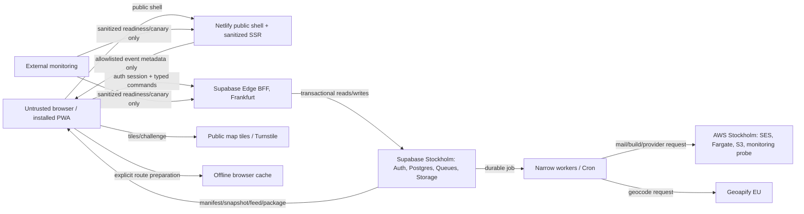

# Promenadis threat model

Status: discovery sign-off baseline, 2026-09-07

This model covers the free launch architecture and its most sensitive asset:
time-bounded publication of residential seller locations. It is a living design
artifact, not a penetration-test report.

## 1. Security objectives and invariants

1. A precise seller location is disclosed only for an approved participation,
   within its consented publication window, and through the bounded event view.
2. Withdrawal, quarantine, closure, postponement, cancellation, and event end
   immediately change authoritative state and cannot be blocked by ordinary
   feature or cost controls.
3. Expired or erased residential data is not republished from CDN state, browser
   cache, retrying jobs, backup restore, or rollback.
4. Roles are event-scoped and server-enforced. A browser never receives broad
   private rows and filters them locally.
5. Public resources contain only allowlisted fields. Reporter, attendee,
   account, authentication, unit, moderation, and audit identities remain out.
6. Visitor GPS and manually chosen starts never leave transient browser state.
7. No operator, administrator, provider, or worker gets ambient access merely
   because it is convenient.
8. Protective commands retain capacity during abuse, quota pressure, degraded
   mode, and an ordinary write freeze.

## 2. Assets

- Precise residential addresses, coordinates, and private entrance/unit details.
- Account email, authentication sessions, MFA/recovery material, and organizer-
  profile ownership.
- Event/team permissions, ownership, publication state, and recovery succession.
- Seller applications, listing text, availability, and live status.
- Reports, reporter contact, moderation evidence, appeals, and admin audit data.
- Public snapshot/safety-feed integrity, hard expiry, and unlisted route tokens.
- Walking-network source/build metadata, event overrides, and safe route edges.
- Queue state, retention tombstones, backup archives, and restore keys.
- Provider credentials, CI identities, deployment artifacts, and DNS/domain
  control.
- Service capacity needed for takedown, expiry, cancellation, and notification.

## 3. Trust boundaries and data flows

Important boundaries:

- The browser, all user-authored content, URLs, provider responses, and webhooks
  are untrusted input.
- Browser-auth boundary updated 2026-09-15: opaque HttpOnly SameSite cookies
  replace browser-readable Supabase credentials. The existing private BFF
  owns encrypted tokens/PKCE state and service-only vault RPCs. Local HTTP is
  the only enabled environment; hosted Secure cookies, dedicated rotated keys,
  abuse budgets and routing require separate verification.
- Netlify handles a public shell and sanitized metadata only; it is not an
  authenticated/private application backend.
- Supabase service-role, AWS, provider, and signing credentials exist only in
  scoped server/CI secret stores.
- Public object storage is safe only because object contents, pointer state,
  expiry, and response headers are independently constrained.
- Offline data was legitimately public when downloaded but becomes stale and
  cannot be remotely retracted; hard expiry and reconnect validation limit harm.

## 4. Threat actors

- Curious visitor scraping legitimately public event data.
- Malicious unauthenticated reporter, relay sender, or login abuser.
- Authenticated seller attempting cross-event/cross-seller access or capacity
  abuse.
- Compromised owner, co-host, moderator, or platform-administrator account.
- Insider/operator mistake, excessive privilege, or unsafe emergency action.
- Malicious or compromised dependency, CI action, deployment identity, provider,
  webhook sender, or graph source.
- Opportunistic attacker exploiting common web, API, storage, or cache flaws.
- Automated traffic exhausting email, geocoding, database, build, or budget
  capacity so protective actions fail.

## 5. Threat scenarios and controls

| Threat | Impact | Primary controls | Required evidence |
| --- | --- | --- | --- |
| Object-level authorization failure | Private address, report, or event data exposed across accounts/events | Typed BFF commands, event-role resolution, RLS, field DTOs, opaque IDs | Cross-event and shared-location denial tests |
| Premature or overlong location publication | Residential location exposed outside consented window | Explicit publication state/window, server clocks, snapshot allowlist, hard expiry, scheduled end/tombstone | Lifecycle tests across time zones/DST; expiry heartbeat |
| Stale CDN/snapshot restores removed pin | Continued disclosure after withdrawal/quarantine/end | Monotonic safety sequence, urgent feed, immutable snapshots, safe pointer transaction, tombstone manifest, cache purge, no blind rollback | End/quarantine/rollback fault-injection tests |
| Offline device retains old public data | User sees stale or withdrawn location | Explicit route preparation, last-refresh/stale warning, hard event expiry, reconnect validation | Offline/end/reconnect real-device test; accepted residual risk text |
| Guessing or resharing unlisted URL | Event becomes broadly accessible | 128-bit token, no referrer, noindex, rotation with `410`, clear user warning | Entropy test, header test, token-rotation test |
| Account takeover or magic-link abuse | Event takeover, fraudulent publication/cancellation | Email verification, enumeration resistance, rate limits/Turnstile, secure session handling, recent auth, TOTP for admins, owner recovery code/successor delay | Auth/session/recovery abuse tests |
| Stale account page after shared-session change | Profile or event change applied to another account | Expected-account fence before every protected domain call; identity-bound component remount; focus/broadcast revalidation; pending OTP bound to displayed email | Two-context profile isolation and stale-cookie write tests |
| Browser credential theft, refresh races or cookie replay | Account takeover, unexpected logout or token rotation failure | No JS-readable Auth credentials; hashed opaque handles; encrypted vault; database leases; live Auth-session binding; 12-hour absolute expiry; local logout revocation | Cookie/DTO/storage inspection, concurrent refresh, lease ownership, Auth revocation and deleted-cookie replay tests |
| Owner lockout or fraudulent transfer | Loss of event control | Exactly one owner, verified co-host acceptance, 24-hour recovery delay, old-address/team notices, no document-based improvisation | Concurrent transfer and recovery state tests |
| Privilege escalation/admin misuse | Bulk disclosure or moderation abuse | Normal mode by default, fresh TOTP elevation, 15-minute expiry, reasons, audit, distinct approval for configured high-risk actions | Elevation-expiry, denied normal-session, two-person tests |
| Malicious UGC, stored XSS, badge impersonation | Visitor compromise, deception, illegal content | Plain-text-first rendering, contextual escaping, schema/length/control validation, CSP, no raw HTML, moderation/reporting | Stored/reflected XSS suite and UGC boundary tests |
| CSV formula injection | Host device command/data exfiltration | Formula-neutralized cells, limited allowlisted export, recent auth, short-lived object | Spreadsheet payload fixtures |
| Report/relay spam or targeted harassment | Operational overload, unwanted mail, missed safety report | Structured short text, no attachments, target/rate buckets, Turnstile, suppression/blocking, safety lane never silently dropped | Shared-NAT, abuse, bounce/complaint tests |
| SSRF/provider-response poisoning | Internal access, bad coordinates, secret disclosure | Fixed provider allowlists, server adapters, timeouts/size/schema validation, no user-chosen upstream URL, normalized stored fields | Malformed/oversize/redirect provider fixtures |
| Webhook forgery/replay | False delivery or job transitions | Signatures, timestamp window, replay key, strict schema, idempotency | Signature and duplicate-delivery tests |
| Queue duplicate/loss or stale job | Duplicate mail, re-publication, missed deletion | Transactional outbox/job record, PGMQ visibility timeout, idempotency, state preconditions, tombstone watermark, dead-letter alerts | Crash/retry/reorder tests |
| Unsafe or tampered walking graph | Visitors routed through invalid/unsafe connection | Checksum-verified source, pinned compiler, isolated build identity, host preview, immutable versions, bounded attested connectors, urgent edge block | Reproducible build/hash and unsafe-edge tests |
| Graph/source license omission | Legal/reputational exposure | Source/checksum/compiler manifest, visible attribution, conservative ODbL treatment, counsel gate | Snapshot/package attribution inspection |
| Secret or CI compromise | Provider/account takeover | Secret stores, no preview secrets, GitHub OIDC to AWS, least privilege, pinned actions, secret scanning, rotation runbook | CI permissions review and rotation exercise |
| Environment confusion | Production data sent to staging or destructive command hits production | Separate projects/domains/secrets/callbacks, synthetic staging only, typed production confirmation, project-reference checks | Environment-isolation tests and inventory review |
| Backup resurrects erased data | Erasure and expired locations reversed | Encrypted immutable 14-day archives, erasure tombstone watermark/replay, isolated restore, no blind production import | Quarterly restore with tombstone validation |
| Logging/monitoring leaks personal data | Secondary disclosure and excess retention | Structured allowlist, no bodies/full URLs/addresses/email/coordinates/UGC, generic monitor endpoints, 30-day expiry | Log schema tests and sample review |
| Resource/cost exhaustion | Outage or inability to remove sensitive data | CDN public reads, quotas/token buckets, backoff, spend caps, reserved protective capacity, optional-work shedding | Load test and quota-failure exercise |
| Dependency or browser feature failure | Broken safety/accessibility path | Locked/scanned dependencies, feature detection, structured-list/manual fallbacks, degraded mode | Dependency scan; no-map/no-worker/no-storage tests |
| Clickjacking/CSRF/open redirect | Unauthorized command or credential theft | CSP/frame controls, secure cookies where applicable, CSRF/origin checks, redirect allowlist | Browser security-header and request-origin tests |

## 6. Privacy-abuse cases

- A public event snapshot can be copied while valid. The design limits event
  scope, fields, discoverability, and lifetime; it does not claim to make public
  pins secret.
- A resident can report unauthorized use of their address without an account.
  One sufficiently complete report quarantines only that physical location; a
  human decides restoration or permanent removal.
- Multiple sellers at one location do not gain visibility into each other's
  accounts or private unit/entrance details.
- Owners see event-team actor display labels for accountable team actions, but
  not reporter identities, private auth identifiers, or unrelated profiles.
- Route optimization, geolocation, and progress must not become a movement-
  analytics channel. Current position never leaves the browser; selected stops
  and progress expire with the event.

## 7. Accepted residual risks

- Anyone may copy or screenshot legitimately public location/listing data.
- An offline device can retain and display data until hard expiry without
  receiving an urgent withdrawal first.
- OpenFreeMap and other free public infrastructure have no Promenadis-backed SLA.
- Email is not end-to-end encrypted, so sensitive legal/safety detail should use
  the minimal structured intake and careful follow-up.
- HttpOnly stops JavaScript from reading the cookie, not from making requests
  after XSS. Windows sharing a cookie jar share authentication; cookies do not
  create per-window isolation. The reported Zen account switch remains an open
  diagnostic question, not an accepted cross-account authorization failure.
- A solo administrator cannot provide independent appeal review or two-person
  approval until a second eligible administrator exists; this is disclosed and
  audited.
- The unpaid pilot has no formal release freeze. Automated safety gates and
  rollback/forward-fix readiness reduce but do not eliminate deployment risk.

These are accepted only for the bounded free pilot. Payment, larger events,
photos, private events, minors, buyer/seller messaging, or a formal SLA trigger a
new review.

## 8. Review triggers and ownership

The operator owns this threat model. Review it:

- before the first closed alpha and again before the first real pilot;
- after any SEV-0 or major SEV-1;
- when a trust boundary, provider, authentication method, public data field,
  retention period, administrator model, or routing pipeline changes;
- before enabling any explicitly deferred feature; and
- at least annually while the service remains active.

Every material threat-model change must update the authorization matrix, data
classification, implementation tests, incident runbook, and launch checklist as
applicable.

## 9. Test mapping (Milestone 6, 2026-11-06)

Local evidence today; "open" marks evidence that needs hosted, real-device
or counsel work before a pilot.

| Threat | Local evidence | Open |
| --- | --- | --- |
| Object-level authorization failure | pgTAP 420 (no browser grants, RLS on every table, no browser-executable function); per-command denial tests in pgTAP 060–410; e2e "protected routes refuse anonymous callers" | Hosted RLS/grant diff before each release |
| Premature or overlong location publication | pgTAP 350 (early visibility, hard expiry, tombstones), 330 (14-day erasure), 430 (expiry beats job lag, erasure boundary, postponement), DST wall-time tests | Real-clock soak during a closed alpha |
| Stale CDN/snapshot restores removed pin | pgTAP 350/360 (feed removals across rebuilds), e2e map test (feed removes a seller without rebuild) | CDN purge verification at the edge |
| Offline device retains old public data | `offline-store` tests (expiry, LRU), e2e walking test (offline banner, reconnect) | Real iPhone/Android offline/reconnect test |
| Guessing or resharing unlisted URL | pgTAP 340 (128-bit keys, rotation 410), e2e landing test (no-index, no-referrer headers) | — |
| Account takeover or magic-link abuse | pgTAP 120–200, 220–260; recovery, TOTP and session e2e tests | Turnstile, hosted Auth rate limits |
| Stale account page after shared-session change | e2e "opaque sessions isolate accounts" | — |
| Browser credential theft, refresh races or cookie replay | `test:local-session-security`, gateway tests, e2e session test | Hosted cookie flags over HTTPS |
| Owner lockout or fraudulent transfer | pgTAP 060–110 | — |
| Privilege escalation/admin misuse | pgTAP 220–250, 320, 400 (elevation required for switches, support, appeals) | Second-admin approval exercised with two real admins |
| Malicious UGC, stored XSS, badge impersonation | Plain-text rendering only (no raw HTML anywhere; JSON-LD escapes `<`), public-pages test; per-response script nonce CSP (`script-src 'self' 'nonce-…'`, `script-src-attr 'none'`), e2e "scripts run only from this origin or with the response nonce" | CSP verified at the CDN edge |
| CSV formula injection | pgTAP 390, e2e export test (`=HYPERLINK` neutralized) | — |
| Report/relay spam or targeted harassment | pgTAP 310, 390, 400 (network and subject buckets, honeypots), incident switches | Turnstile |
| SSRF/provider-response poisoning | Geocoder fixture adapter with fixed hosts; routing source checksum | Hosted Geoapify response validation |
| Webhook forgery/replay | None yet (no webhooks locally) | SES feedback webhook signatures |
| Queue duplicate/loss or stale job | Worker node tests (lease-fenced acknowledgement), `test:local-notifications` (no replay) | Hosted queue visibility timeouts |
| Unsafe or tampered walking graph | pgTAP 370, routing build tests, e2e walking test (preview, connectors, live block) | Hosted pinned compiler |
| Graph/source license omission | Package and planner show ODbL attribution (routing tests, e2e) | Counsel review |
| Secret or CI compromise | `pnpm security:scan` in `verify` | CI permissions review, rotation exercise |
| Environment confusion | Local-only adapters fail closed outside `kong` | Separate hosted projects |
| Backup resurrects erased data | `test:local-backup` (replay removes an erased account; tampering refused), pgTAP 410 | Quarterly real-archive restore |
| Logging/monitoring leaks personal data | Structured operation log allowlist in the BFF; `/status` returns one field (e2e) | Log schema review on hosted logs |
| Resource/cost exhaustion | `pnpm test:local-load` (envelope sizes, 304 polling, origin throughput), `pnpm test:local-concurrency` (capacity and single-flight races) | Provider quota failure tests, CDN hit-rate check |
| Dependency or browser feature failure | Map/worker/storage fallbacks covered by component tests | Real-device matrix |
| Clickjacking/CSRF/open redirect | e2e header test (`frame-ancestors 'none'`, `X-Frame-Options`), origin and gateway header checks | — |
